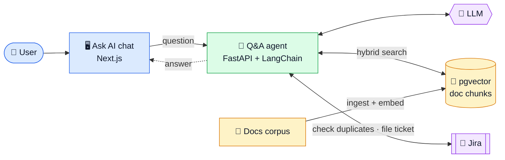

# Dailoqa

Dailoqa is a documentation site with an AI assistant built in. You can read the LangChain, LangGraph and Deep Agents docs, and ask the assistant questions about them. The assistant answers only from the docs and cites the sections it used. It can also turn a bug report or feature request into a Jira ticket, after checking that the issue isn't already filed.

## What it does

- **Documentation Q&A.** Answers questions using hybrid retrieval (vector search plus keyword search) over the docs, and cites the sections it used. If the docs don't cover a question, it says so instead of guessing.
- **Bug reports.** Asks only for missing details, collects screenshots or recordings, searches Jira for duplicates, then either links the user to an existing issue or files a new one.
- **Feature requests.** The same flow as bug reports, for new ideas.
- **Human approval.** Nothing is written to Jira until the user approves the exact ticket shown in the chat.
- **Live updates.** Replies stream to the browser over Server-Sent Events, and users get notified when their ticket is filed.

## Architecture



| Part | Stack | Role |
|---|---|---|
| `Frontend/` | Next.js 16, React 19, Tailwind 4 | Docs pages, "Ask AI" chat, Google sign-in |
| `Backend/` | FastAPI, LangChain / LangGraph | Q&A agent, docs search, Jira tickets, chat and SSE APIs |
| `Database/` | PostgreSQL + pgvector | Docs index and conversation history |

- **Agent:** follows the `documentation-qa` skill in `Backend/skills/` and must search the docs before answering.
- **Search:** docs are converted to Markdown, embedded with `BAAI/bge-small-en-v1.5`, and searched with combined vector and keyword search. If nothing relevant is found, the agent says the docs don't cover it.
- **Tickets:** for a bug or feature request, the agent checks Jira for duplicates and files a ticket only after the user approves it.

## Getting started

### Prerequisites

- Python 3.12+
- Node.js 20+
- PostgreSQL with the `pgvector` extension
- An LLM endpoint (an OpenAI-compatible LiteLLM gateway by default, or Anthropic)
- A Jira Cloud site and API token (for ticket creation)
- Google OAuth client credentials (for sign-in)

### 1. Database

Create `Backend/.env` first (see step 2). Then, on Windows:

```powershell
./Database/scripts/setup.ps1
```

This resets and creates the `dailoqa` database and applies the files in `Database/schema/` in order. On other systems, run the same files with `psql`:

```bash
psql -U <user> -d postgres -f Database/scripts/reset.sql
psql -U <user> -d dailoqa  -f Database/scripts/provision.sql
```

### 2. Backend

```bash
cd Backend
cp .env.example .env          # fill in DATABASE_URL, SERVICE_JWT_SECRET, LLM_*, JIRA_*
pip install -e ".[dev]"

python -m app.rag.ingest      # build the docs index (safe to re-run)
python run.py                 # API on http://127.0.0.1:8000
python -m app.worker          # in a second terminal: ticket worker
```

Or run the API and the worker with Docker:

```bash
cd Backend
docker compose up --build
```

`docker-compose.yml` reads `DATABASE_URL_DOCKER` (usually pointing at `host.docker.internal`) and mounts `Frontend/tmp` as the shared evidence folder.

### 3. Frontend

```bash
cd Frontend
cp .env.example .env.local    # fill in DATABASE_URL, SESSION_SECRET, ENCRYPTION_KEY, GOOGLE_*, SERVICE_JWT_SECRET
npm install
npm run dev                   # http://localhost:3000
```

`SERVICE_JWT_SECRET` must be the same in the frontend and the backend. The frontend uses it to sign the short-lived tokens it sends to the API.

## Configuration

Main backend settings (all listed in `Backend/.env.example`):

| Variable | Purpose |
|---|---|
| `DATABASE_URL` | Postgres connection (`postgresql+psycopg://…`) |
| `SERVICE_JWT_SECRET` | Shared secret for frontend → backend auth |
| `LLM_PROVIDER`, `LLM_KEY`, `LLM_BASE_URL` | Model provider (`litellm` by default, or `anthropic`) |
| `LLM_MODEL_AGENT` / `_CLASSIFIER` / `_TITLER` | Optional model override for each role |
| `JIRA_SITE_URL`, `JIRA_EMAIL`, `JIRA_API_TOKEN`, `JIRA_PROJECT_KEY` | Jira connection |
| `JIRA_WEBHOOK_SECRET` | Checks incoming Jira webhooks |
| `EVIDENCE_ROOT` | Folder for uploaded screenshots and recordings |
| `RAG_ENABLED`, `DOCS_PATH`, `DOCS_LANGUAGE`, `EMBEDDING_MODEL` | Docs index settings |
| `RAG_TOP_K`, `SEMANTIC_MAX_DISTANCE`, `LEXICAL_MIN_RANK`, `RAG_DIVERSITY_SLOTS` | Search tuning (re-run the evaluation after changing the docs) |

## Testing

```bash
# Backend (skip live tests, which call the real model and cost tokens)
cd Backend && pytest -m "not live"

# Frontend
cd Frontend && npm test && npm run lint
```

## Project structure

```
.
├── Backend/
│   ├── src/app/
│   │   ├── agent/        # agent factory, middleware, tools, prompts
│   │   ├── api/          # FastAPI routers
│   │   ├── rag/          # ingest, embeddings, search, evaluation
│   │   ├── jira/         # Jira client, ADF builder, similar-report search
│   │   ├── worker/       # background ticket jobs
│   │   ├── sse/          # event stream registry and Postgres LISTEN/NOTIFY
│   │   └── db/           # models and repositories
│   ├── skills/           # agent skill playbooks (SKILL.md)
│   ├── docs-corpus/      # raw and formatted documentation
│   ├── docs-formatter/   # MDX → Markdown converter
│   ├── eval/             # retrieval golden set
│   └── tests/
├── Frontend/
│   └── src/
│       ├── app/          # Next.js routes: landing, docs, ask-ai, API proxies
│       └── features/     # auth, chat, docs, dashboard, backend-client
└── Database/
    ├── schema/           # SQL schema files
    └── scripts/          # setup, provision, reset
```
